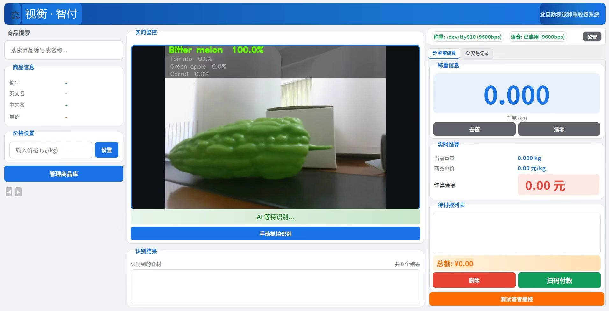
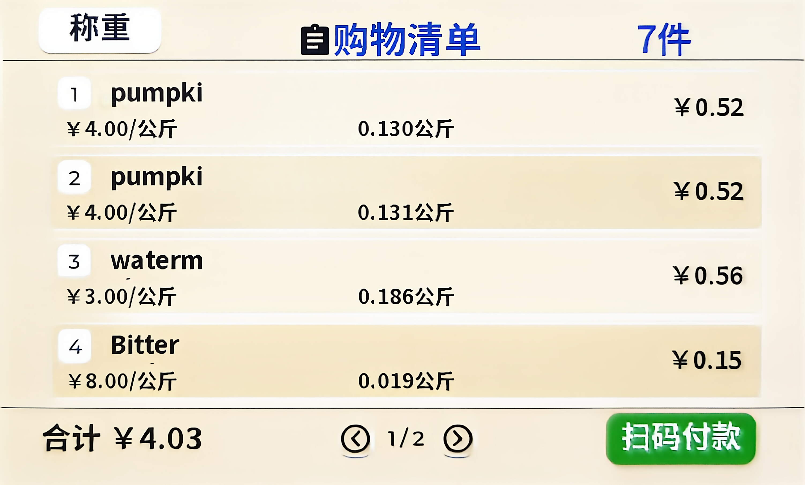
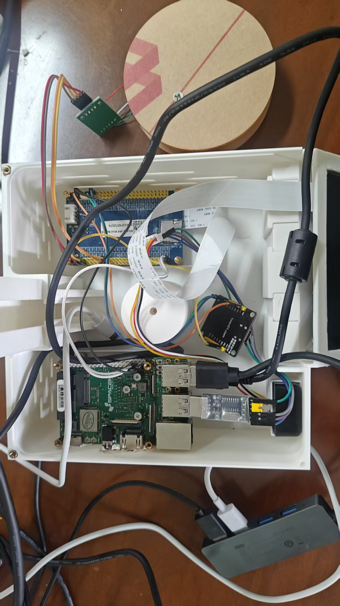

# 视衡·智付 · 基于进迭时空 K1 的全自助视觉称重收费系统

在 **MUSE Pi Pro（SpacemiT K1）** 上运行的离线智能称重终端：摄像头、电子秤、语音模块三路外设协同，
本地 ONNX 推理完成果蔬识别，实现"放置 → 识别 → 称重 → 计价 → 语音播报 → 扫码支付"全流程无人化。



---

## 特性

- **完全离线**：识别、计价、播报全部本地完成，无云端依赖，顾客图像不出设备
- **三模态协同**：视觉（USB 摄像头）+ 语音（串口 ASR 指令 / TTS 播报）+ 称重（串口电子秤）
- **两级目标裁剪**：先定位白色托板、再定位板上商品，实机准确率由 60% 提升至 100%
- **类别白名单 + 2 帧一致投票**：消除相近品类误判与单帧抖动，识别结果可复现
- **无感交互**：重量稳定自动抓拍，语音指令完成去皮 / 结算 / 取消

---

## 效果

| 主界面（三列布局） | 副屏购物清单 | 内部结构 |
|---|---|---|
|  |  |  |

---

## 系统架构

```
┌──────────────────────────────────────────────────┐
│  交互层   PyQt5 界面 · 语音播报 · 触摸操作          │
├──────────────────────────────────────────────────┤
│  业务层   商品库(SQLite) · 计价 · 待付款列表        │
├──────────────────────────────────────────────────┤
│  智能层   ONNX 分类模型 · OpenCV 两级裁剪           │
├──────────────────────────────────────────────────┤
│  推理层   onnxruntime-spacemit · CPU 4 线程        │
├──────────────────────────────────────────────────┤
│  系统层   Bianbu LXQt · V4L2 · 串口驱动             │
└──────────────────────────────────────────────────┘

    摄像头 ─┐
    电子秤 ─┼──► 主程序调度 ──► 裁剪 ──► ONNX ──► 白名单/投票 ──► 计价 ──► 语音
    语音模块┘
```

---

## 性能

### 推理延迟（320×320，CPU 4 线程）

| 指标 | 数值 |
|---|---|
| 平均 | **649 ms** |
| 中位 | 650 ms |
| P95 | 658 ms |
| 理论吞吐 | 1.5 FPS |

### 预处理与端到端

| 环节 | 耗时 |
|---|---|
| 托板裁剪 | 2.4 ms |
| 物体裁剪 | 1.9 ms |
| 缩放归一化 | 1.4 ms |
| 2 帧投票 | 1–2 s |
| **端到端** | **约 2 s** |

### 识别准确率（25 张实拍，5 类各 5 张）

| 预处理 | Top-1 |
|---|---|
| 原图直接缩放 | 60.0% |
| 中心裁剪 70% | 100% |
| 白底缩小 70% | 100% |
| **两级裁剪（本方案）** | **实机稳定** |

---

## 快速开始

### 1. 依赖

```bash
sudo apt update
sudo apt install -y python3-pyqt5 python3-opencv python3-numpy python3-serial
pip3 install onnxruntime        # 或使用系统预装的进迭时空优化版
```

### 2. 获取模型

模型 `best6.onnx`（20.8 MB）未纳入版本库，请从 Releases 下载：

**方式一：浏览器**

打开 https://github.com/PP-Mike/WeighSight-SmartPay/releases/latest ，下载 `best6.onnx`，放入程序同级的 `model/` 目录。

**方式二：命令行**

```bash
mkdir -p model
wget -O model/best6.onnx \
  https://github.com/PP-Mike/WeighSight-SmartPay/releases/latest/download/best6.onnx
```

> 模型路径由程序内的 `MODEL_PATH = './model/best6.onnx'` 决定，需与运行目录保持一致。

### 3. 初始化商品库

```bash
python3 tools/init_db.py        # 生成 fruit_vegetables.db（13 类，可自行改价）
```

### 4. 运行

```bash
python3 aiscale_system_fin_pro7.py
```

或从 SSH 启动（自动处理 X11/Wayland）：

```bash
chmod +x run_gui.sh
./run_gui.sh
```

---

## 硬件接线

| 部件 | 接口 | 说明 |
|---|---|---|
| 摄像头 | `/dev/video20` | USB UVC，640×480 MJPG |
| 电子秤 | `/dev/ttyS10` | 9600，STM32 称重仪表，重量帧 + 语音指令 |
| 语音模块 | `/dev/ttyUSB0` | 9600，USB 转 TTL |
| 显示屏 | MIPI / HDMI | PyQt5 界面 |

串口帧格式：帧头 `AA 55`、长度、数据、累加和校验、帧尾 `0D 0A`；语音指令以 `AA CMD FE 55` 内嵌在数据流中。

---

## 目录结构

```
.
├── aiscale_system_fin_pro7.py   主程序（PyQt5 + 四线程）
├── run_gui.sh                   SSH 启动脚本（自动识别 X11/Wayland）
├── bench_onnx.py                推理延迟与准确率测试
├── bench_variants.py            多种预处理方式对比
├── camera_bench.py              摄像头采集配置对比
├── tools/init_db.py             商品库初始化
├── docs/技术文档.md              优化策略 / 用户文档 / 部署说明 / 测试报告
└── images/                      README 配图
```

---

## 优化历程

1. **输入治理**：模型在棚拍图上 100%，接实机后苹果被判成番茄。定位到"画面构成与训练分布不一致"，
   用 4.3 ms 的两级裁剪把输入拉回训练分布，准确率回到 100%。
2. **缩小决策空间**：13 类模型会把梨判成柠檬，按白名单屏蔽 8 类后误判消失。
3. **判决稳定**：单帧会抖动，抓拍后连续 2 帧一致即出结果，同一商品多次测试结果一致，端到端约 2 秒。
4. **瓶颈定位**：程序内帧率仅 2.5 fps，定位到工作线程创建 `QPixmap` 的问题并改用 `QImage`；
   进一步用 `v4l2-ctl` 确认驱动层只有 5 fps，属摄像头固件限制。

详见 [docs/技术文档.md](docs/技术文档.md)。

---

## 许可

MIT License，详见 [LICENSE](LICENSE)。
